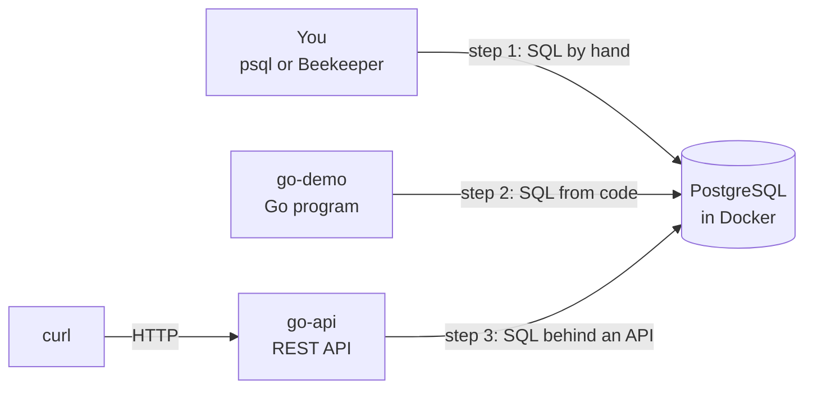
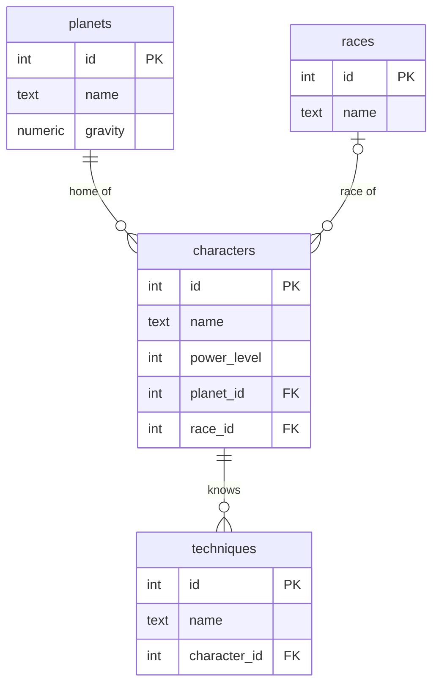

# sql-z

**English** · [Español](README.es.md)

**Learn essential SQL with Dragon Ball data, then see how real code uses it.**
No prior database experience needed.

## The path

| # | Guide | What you'll do |
|---|-------|----------------|
| 0 | [Setup](docs/00-setup.md) | Install Docker and Go, start the database |
| 1 | [SQL by hand](docs/01-sql.md) | Read, filter, sort, summarize, join, and change data in `psql` or Beekeeper |
| 2 | [SQL from code](docs/02-go-demo.md) | Run the same queries from a Go program and compare |
| 3 | [SQL behind an API](docs/03-go-api.md) | Follow a value from an HTTP request (GET, POST, PUT, DELETE) into the table |
| 4 | [Next steps](docs/04-next-steps.md) | Coding challenges and topics to learn next |

Stuck? See [Troubleshooting](docs/troubleshooting.md).

## Cheatsheet

Keep the **[SQL cheatsheet](https://rmpato.github.io/sql-z/docs/cheatsheet.html)** open while you work. It puts every lesson topic on one page, with copyable examples.

It's also in the repo at `docs/cheatsheet.html`, so it works offline. Open it in your browser:

```bash
xdg-open docs/cheatsheet.html   # Ubuntu / Linux
open docs/cheatsheet.html       # macOS
start docs/cheatsheet.html      # Windows (Git Bash)
```

## Quick start

Already have Docker and Go 1.22+? Then:

```bash
git clone https://github.com/rmpato/sql-z.git
cd sql-z
./connect.sh        # starts the database and opens psql
```

Otherwise start with [Setup](docs/00-setup.md).

## How it fits together

Everything talks to the same database. Each step adds one layer:



## The database

Four tables, linked by ids. A character can have no race (that's Frieza), so that link is optional:



| Table | Holds | Links to |
|-------|-------|----------|
| `planets` | Earth, Namek, … | |
| `races` | Saiyan, Human, … | |
| `characters` | Goku, Vegeta, … | a planet and a race |
| `techniques` | Kamehameha, … | a character |

Defined in [`sql/01_schema.sql`](sql/01_schema.sql), filled by [`sql/02_seed.sql`](sql/02_seed.sql).

## Commands

| Task | Command |
|------|---------|
| Start the database | `docker compose up -d --wait` |
| Open psql | `./connect.sh` |
| Stop (keeps data) | `docker compose down` |
| Reset to fresh data | `docker compose down -v && docker compose up -d --wait` |

**Connection details** (for GUI clients and code):

| Host | Port | Database | User | Password |
|------|------|----------|------|----------|
| localhost | 5432 | dragonball | goku | kamehameha |

## What's in the repo

```
sql/
  01_schema.sql     table definitions
  02_seed.sql       starting data
  03_examples.sql   the SQL lesson (step 1)
  03_ejemplos.sql   the same lesson in Spanish
go-demo/            step 2: a Go program running SQL
go-api/             step 3: a REST API backed by SQL
docs/               the guides linked above, plus cheatsheet.html
docs/es/            the guides and cheatsheet in Spanish
connect.sh          start the database and open psql
```
