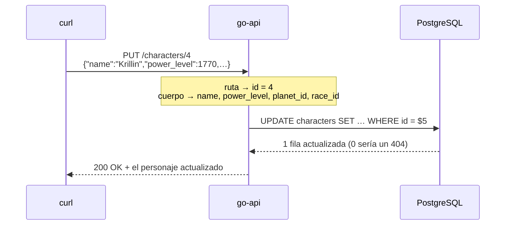

# 3. SQL detrás de una API

[← Volver al README](../../README.es.md) · [English](../03-go-api.md)

**Objetivo:** seguir un valor desde un pedido HTTP, hasta una consulta SQL, hasta la tabla. Es lo que hace la mayor parte del código backend todo el día.

## Ejecutala

```bash
cd go-api
go run .
```

La API queda escuchando en `http://localhost:8080`. Dejá esta terminal abierta: muestra cada pedido y el SQL que ejecuta.

## Cómo un pedido se convierte en consulta

Cada endpoint toma sus datos de una parte distinta del pedido:

| Pedido | Los datos vienen de | SQL que ejecuta |
|--------|---------------------|-----------------|
| `GET /characters?min_power=3000` | query string (lo que va después del `?`) | `SELECT … WHERE power_level >= $1` |
| `GET /characters/{id}` | la ruta de la URL | `SELECT … WHERE id = $1` |
| `POST /characters` | el cuerpo JSON | `INSERT … VALUES ($1, $2, $3, $4)` |
| `PUT /characters/{id}` | la ruta + el cuerpo JSON | `UPDATE … SET … WHERE id = $5` |
| `DELETE /characters/{id}` | la ruta de la URL | `DELETE … WHERE id = $1` (en una transacción) |

## Seguí un pedido

Este es un `PUT` de principio a fin. El id viene de la URL, los valores nuevos del cuerpo JSON, y los dos terminan en un solo `UPDATE`:



## Armá tres ventanas

| Ventana | Para |
|---------|------|
| 1. Terminal de la API | ver el pedido, el SQL y los valores de `$1, $2, …` |
| 2. Otra terminal | mandar pedidos con `curl` |
| 3. psql o Beekeeper | revisar qué cambió de verdad en la tabla |

Para cada pedido de abajo: mandalo, leé el log y después hacé un `SELECT` para confirmar.

## Probá cada método

**GET: leer**

```bash
curl localhost:8080/characters
curl "localhost:8080/characters?min_power=3000"
curl localhost:8080/characters/1
```

**POST: crear.** El cuerpo JSON se convierte en los valores del INSERT. Fijate el `id` en la respuesta.

```bash
curl -X POST localhost:8080/characters \
  -d '{"name":"Bulma","power_level":12,"planet_id":1,"race_id":2}'
```

**PUT: actualizar.** El id viene de la URL y los valores nuevos del cuerpo. Mandá todos los campos.

```bash
curl -X PUT localhost:8080/characters/4 \
  -d '{"name":"Krillin","power_level":1770,"planet_id":1,"race_id":2}'
```

**DELETE: borrar.** También borra las técnicas del personaje, en una sola transacción.

```bash
curl -i -X DELETE localhost:8080/characters/4
```

El log del servidor para el POST se ve así:

```
→ POST /characters
  SQL: INSERT INTO characters (name, power_level, planet_id, race_id) VALUES ($1, $2, $3, $4) RETURNING id
       $1=Bulma $2=12 $3=1 $4=2
```

## Probá romperla

| Probá | Te devuelve | Por qué |
|-------|-------------|---------|
| `curl localhost:8080/characters/999` | `404 not found` | la consulta se ejecutó pero no encontró filas |
| POST con `"planet_id": 99` | `400` | la clave foránea lo rechaza (lección 7.6) |
| `curl localhost:8080/characters/abc` | `400` | la API revisa los datos antes de ejecutar SQL |

Compará también el código del DELETE en [`go-api/main.go`](../../go-api/main.go) con la lección **8.2**. Es la misma transacción, escrita en Go.

Pará el servidor con `Ctrl+C`.

> Los dos programas en Go se conectan a `localhost:5432` por defecto. Definí la variable de entorno `DATABASE_URL` para usar otra base de datos.

---

**Siguiente:** [4. Próximos pasos →](04-proximos-pasos.md)
